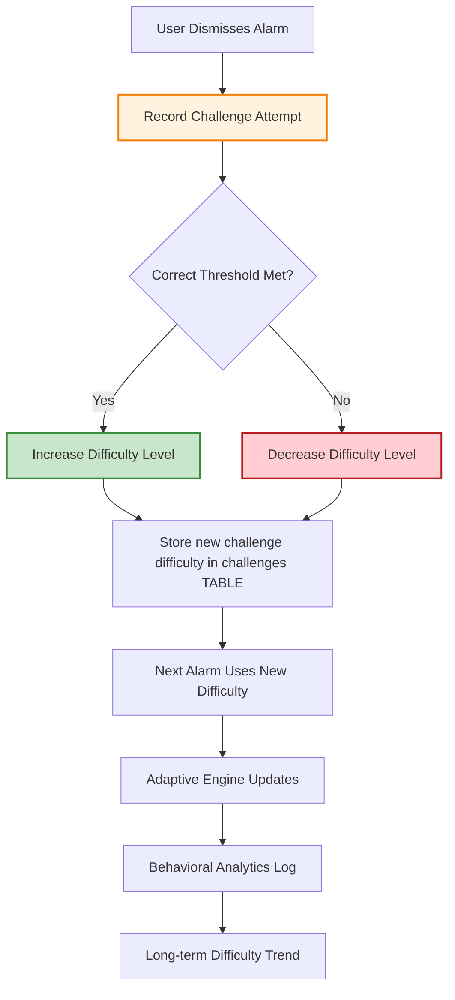
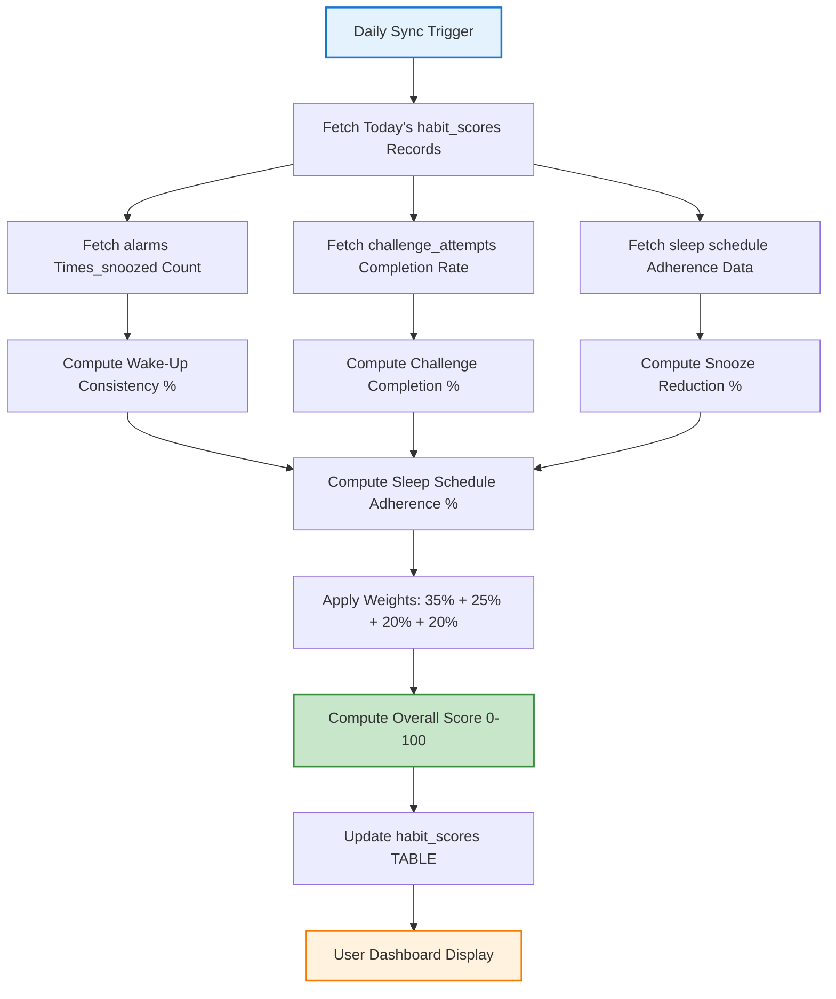

# SRS.md - Software Requirements Specification (IEEE Format)

**System**: Intelligent Cognitive Alarm Platform  
**Version**: 1.3  
**Date**: 2026-09-06  
**Organization**: CerebroKognit Project  
**Contact**: architect@cerebrokognit.local

> **Documentation Status**: This revision reflects the actual implementation state discovered during a deep codebase analysis. Requirements marked with an update indicator reflect known gaps between spec and implementation.

---

## 1. Introduction

### 1.1 Purpose
This Software Requirements Specification (SRS) documents the functional and non-functional requirements for the Intelligent Cognitive Alarm Platform. It serves as the definitive reference for developers, testers, architects, and stakeholders throughout the development lifecycle. All requirements trace back to the Product Requirements Document (PRD.md) and are verified via test cases in the QA plan.

### 1.1.1 Scope
This document covers:
- Backend FastAPI service (Python 3.11, SQLAlchemy 2.0, PostgreSQL 15)
- Mobile React Native/Expo client (iOS and Android)
- Web React.js dashboard (Tailwind CSS, Chart.js/Plotly)
- Offline-first data synchronization
- JWT-based authentication and RBAC
- Adaptive difficulty and habit scoring engines
- ML model inference for cognitive challenges

### 1.2 Definitions, Acronyms, and Abbreviations
| Term | Definition |
|---|---|
| API | Application Programming Interface |
| JWT | JSON Web Token |
| RBAC | Role-Based Access Control |
| ML | Machine Learning |
| NB | Not Blocked |
| FCM | Firebase Cloud Messaging |
| API | Representational State Transfer (REST) |
| UI | User Interface |
| UX | User Experience |
| ER | Entity-Relationship |
| API | Application Programming Interface |

### 1.3 References
- PRD.md: Product Requirements Document (project root)
- SRS.md: This document (project root)
- context.md: System Memory & State Anchor (project root)
- API Contract Registry: Section 7 of SRS.md and context.md
- Technology Stack: context.md → Technology Stack Version Matrix
- Design Documents: AI_Intelligent Cognitive Alarm Platform.pdf

### 1.4 Overview
- Section 2: Functional Requirements (ordered by feature module)
- Section 3: Non-Functional Requirements (security, performance, reliability, etc.)
- Section 4: Interface Specifications (API, Data, User)
- Section 5: Data Flow Diagrams (Mermaid format)
- Section 6: PostgreSQL ER Diagrams (Mermaid format)
- Section 7: API Endpoint Contracts (Pydantic v2 models, authentication)
- Section 8: Offline-First Sync Protocol
- Section 9: Acceptance Criteria and Test Requirements

---

## 2. Functional Requirements

### 2.1 Authentication & Authorization

| Requirement ID | Requirement Text | Priority | Notes |
|---|---|---|---|
| FR-AUTH-001 | The system shall support user registration with email and password hash storage. | High | Passwords must be hashed using bcrypt (or equivalent) with minimum 12-round cost. |
| FR-AUTH-002 | The system shall support user login via JWT authentication. | High | JWT signed with HS256 algorithm. Access token expiry configurable (default 60 mins). Refresh token expiry configurable (default 30 days). |
| FR-AUTH-003 | The system shall implement role-based access control with three roles: User, Wellness Coach, Administrator. | High | ✅ **ENFORCED as of M1 (2026-09-05).** `Role`/`user_roles` tables exist; RBAC enforced via `require_roles()` in `backend/app/api/deps.py`. `/dashboard/users` requires staff, `/dashboard/analytics` requires admin (verified 403 in smoke test). Roles are auto-assigned on registration; seeds include a demo `Administrator` user. |
| FR-AUTH-004 | The system shall validate JWT `Authorization: Bearer <token>` header on protected endpoints. | High | Missing/invalid token returns `401 Unauthorized` with error code `ERR_AUTH_001`. |
| FR-AUTH-005 | The system shall support OAuth2 login (Google) as alternative to local registration. | Medium | Optional; OAuth2 user profile linked to existing or newly created local user. |

### 2.2 User Profile & Habit Management

| Requirement ID | Requirement Text | Priority | Notes |
|---|---|---|---|
| FR-UP-001 | The system shall allow users to create and manage their profile including preferred wake-up time, sleep duration, time zone, productivity goals, difficulty preference, and habit preferences. | High | Stored in `users` table and mirrored in `habit_scores` daily. |
| FR-UP-002 | The system shall track and store daily habit scores comprising wake-up consistency (35%), challenge completion (25%), snooze reduction (20%), and sleep schedule adherence (20%). | High | Composite overall_score computed as weighted sum; stored in `habit_scores` table with `date` (YYYY-MM-DD). |
| FR-UP-003 | The system shall allow users to update their difficulty preference (Beginner → Easy → Medium → Hard → Expert). | Medium | Affects adaptive challenge selection in the Cognitive Alarm Engine. |
| FR-UP-004 | The system shall store user's sleep schedule and time zone for circadian-aware alarm scheduling. | High | Used by smart alarm scheduling module; timezone offset stored per user. |

### 2.3 Alarm Scheduling System

| Requirement ID | Requirement Text | Priority | Notes |
|---|---|---|---|
| FR-AS-001 | The system shall support creation of the following alarm types: Daily, Weekday, Weekend, One-Time, Smart Adaptive. | High | `alarm_type` column in `alarms` table; enum constraint. |
| FR-AS-002 | The system shall allow recurring alarm schedules with configurable recurrence rules. | High | `next_trigger` computed based on recurrence rule and user's time zone. |
| FR-AS-003 | The system shall support smart adaptive alarms that automatically select challenge type and difficulty based on user history. | High | `alarm_type = 'Smart Adaptive'`; uses adaptive difficulty engine inputs. |
| FR-AS-004 | The system shall compute and store `next_trigger` timestamp for each alarm. | High | Updated each time alarm is dismissed or modified. |
| FR-AS-005 | The system shall support snooze tracking: increment `times_snoozed` on each snooze action. | High | `times_snoozed` column in `alarms` table; contributes to snooze_reduction habit score component. |

### 2.4 Cognitive Challenge Engine

| Requirement ID | Requirement Text | Priority | Notes |
|---|---|---|---|
| FR-CE-001 | The system shall generate cognitive challenges of the following types: Math, Logic, Memory, Word, Pattern, Riddle, QuickQuiz. | High | `challenge_type` column in `challenges` table; enum constraint matching PRD. |
| FR-CE-002 | The system shall support 5 difficulty levels: Beginner, Easy, Medium, Hard, Expert. | High | `difficulty` column in `challenges` table; enum constraint. |
| FR-CE-003 | The adaptive difficulty engine shall adjust challenge difficulty based on user performance: increase on consistent success, decrease on repeated failure. | High | See FR-DA-001 for detailed adjustment algorithm. |
| FR-CE-004 | The system shall validate challenge completion: user must answer all questions correctly or meet threshold within time limit. | High | ✅ **Implemented (M2):** `POST /challenges/submit` performs server-authoritative verification against the attempt snapshot; `puzzle_payload` contains no answer (smoke_m2 no-leak check). |
| FR-CE-005 | The system shall generate personalized challenge selection based on user's difficulty preference, past performance, and time-of-day engagement. | Medium | Uses behavioral analytics inputs; fallback to default difficulty if no history exists. |
| FR-CE-006 | The system shall store challenge description and metadata in the `challenges` table. | High | `title` and `description` fields; used for display and logging. |

### 2.5 Wake-Up Verification Module

| Requirement ID | Requirement Text | Priority | Notes |
|---|---|---|---|
| FR-WV-001 | The system shall require challenge completion before alarm can be dismissed. | High | ✅ Implemented: attempt snapshot created at `/next`; dismiss only after `completed = true` + all-correct + user-owned (smoke_m2 verified 400/404 paths). |
| FR-WV-002 | The system shall support multi-step challenges (3-5 questions) for deeper wake-up verification. | Medium | Configurable per alarm type; default is single challenge with configurable question count. |
| FR-WV-003 | The system shall track consecutive correct answers as a verification metric. | Medium | Stored in `challenge_attempts`; used by adaptive difficulty engine. |
| FR-WV-004 | The system shall support time-based challenges (user must complete within N seconds). | Medium | Time limit configurable per challenge type; default thresholds: Math 60s, Logic 90s, Memory 45s. |
| FR-WV-005 | The system shall record `start_time` and `end_time` for each challenge attempt. | High | Timestamps stored in `challenge_attempts`; used to compute `time_taken_seconds`. |

### 2.6 Behavioral Analytics Engine

| Requirement ID | Requirement Text | Priority | Notes |
|---|---|---|---|
| FR-BA-001 | The system shall analyze snooze pattern trends over time (daily, weekly, monthly). | High | Aggregated from `alarms.times_snoozed` and `challenge_attempts`. |
| FR-BA-002 | The system shall track wake-up behavior: successful dismissals, failed attempts, average time-to-dismiss. | High | Derived from `challenge_attempts.start_time`/`end_time` and `alarms` table. |
| FR-BA-003 | The system shall correlate productivity metrics with wake-up consistency (if user logs productivity data). | Low | Optional; user-defined productivity goals stored and correlated. |
| FR-BA-004 | The system shall analyze sleep pattern analytics: bedtime consistency, sleep duration vs. target. | High | Ingested from user-provided sleep data; stored for habit score computation. |

### 2.7 Recommendation Engine

| Requirement ID | Requirement Text | Priority | Notes |
|---|---|---|---|
| FR-RE-001 | The system shall generate sleep improvement recommendations based on sleep schedule patterns. | Medium | Uses habit score data; suggests bedtime adjustments in 15-min increments. |
| FR-RE-002 | The system shall provide wake-up optimization suggestions (optimal wake-up time, challenge type). | Medium | Based on user's historical performance and difficulty adaptation. |
| FR-RE-003 | The system shall offer habit improvement guidance (e.g., "Your snooze count increased 20% this week"). | Medium | Triggered when behavioral thresholds are crossed. |
| FR-RE-004 | The system shall provide personalized challenge recommendations based on difficulty history. | Low | Suggest new challenge types user hasn't attempted or needs practice in. |

### 2.8 Dashboard & Analytics

| Requirement ID | Requirement Text | Priority | Notes |
|---|---|---|---|
| FR-DD-001 | The system shall provide a User Dashboard displaying: habit scores, alarm history, wake-up statistics, challenge performance. | High | React.js component consuming `/api/v1/habits/score` and `/api/v1/analytics/me`. |
| FR-DD-002 | The system shall provide a Wellness Coach Dashboard displaying: user behavior insights, habit adherence analytics, sleep trend reports, progress monitoring. | High | ⚠️ **NOT IMPLEMENTED.** Admin-lite access and coach user cohort filtering do not exist. |
| FR-DD-003 | The system shall provide an Admin Dashboard displaying: user management, platform analytics, recommendation monitoring, system reports. | High | ⚠️ **PARTIAL.** Backend endpoints exist and RBAC is now enforced (M1). Remaining: no Admin UI page in the web dashboard (M4). |
| FR-DD-004 | Dashboards shall support responsive design for mobile, tablet, and desktop form factors. | Medium | Tailwind CSS utility-first responsive utilities. |

### 2.9 Notification & Reminder System

| Requirement ID | Requirement Text | Priority | Notes |
|---|---|---|---|
| FR-NT-001 | The system shall support bedtime reminders: configurable countdown to target bedtime. | High | Configurable trigger time (e.g., 1 hour before target bedtime). |
| FR-NT-002 | The system shall support wake-up reminders with customizable alarm tones and snooze behavior prompts. | Medium | Stored in `alarms`; played via mobile OS notification APIs. |
| FR-NT-003 | The system shall send habit alerts: streak notifications, snooze increase warnings, milestone celebrations. | Medium | Fired via Firebase Cloud Messaging or native push. |
| FR-NT-004 | The system shall send challenge reminders: if alarm dismissed without challenge (e.g., snoozed), prompt on next ring. | Medium | Ensures cognitive engagement per alarm cycle. |

### 2.10 Reports & Export System

| Requirement ID | Requirement Text | Priority | Notes |
|---|---|---|---|
| FR-REP-001 | The system shall generate habit reports (PDF) with daily/weekly/monthly trend analysis. | High | Export endpoint; uses WeasyPrint or Chrome headless for PDF generation. |
| FR-REP-002 | The system shall generate wake-up reports (PDF/CSV) with wake-up timestamps, snooze counts, success rates. | High | Data from `alarms` and `challenge_attempts` tables. |
| FR-REP-003 | The system shall generate challenge performance reports (PDF/CSV) with quiz analysis: types attempted, accuracy, difficulty progression. | Medium | Data from `challenges` and `challenge_attempts`. |
| FR-REP-004 | The system shall generate productivity reports (PDF/CSV) correlating wake-up consistency with user-defined productivity goals. | Low | Optional; user-provided data. |
| FR-REP-005 | The system shall generate sleep analytics reports (PDF) with bedtime/wake-time trends and sleep duration analysis. | High | Data from user-provided sleep schedule + computed adherence. |
| FR-REP-005 | All reports shall be exportable in PDF and Excel (.xlsx) formats. | High | Backend rendering; frontend download button. |

### 2.11 Offline-First Sync Protocol

| Requirement ID | Requirement Text | Priority | Notes |
|---|---|---|---|
| FR-OFF-001 | The system shall cache cognitive challenges locally on the mobile device for offline access. | High | Expo SQLite or AsyncStorage; cache key format: `puzzle:{challengeId}:{version}`. |
| FR-OFF-002 | The system shall mark local cache entries with a `synced: boolean` flag and `last_sync_at: timestamp`. | High | Enables idempotent background sync. |
| FR-OFF-003 | The system shall perform idempotent background sync when connectivity is restored (transition from offline to online). | High | Uses PostgreSQL `ON CONFLICT (upsert)` for all sync operations. |
| FR-OFF-004 | The system shall batch telemetry events in groups of ≤ 20 per HTTP POST for sync. | Medium | Reduces payload size; retry with exponential backoff on failure. |
| FR-OFF-005 | The system shall detect online/offline state and only attempt sync on online transition. | Medium | Using React Native `NetInfo` or Expo connectivity API. |
| FR-OFF-006 | The system shall retry failed sync operations with exponential backoff (max 3 attempts). | High | Failed records marked with `retry_count` and `last_retry_at`. |
| FR-OFF-007 | The system shall never lose data on sync retry: idempotent upsert ensures no duplicate records. | Critical | Primary key or unique constraint on `(user_id, challenge_id, date)` for attempt records. |

---

## 3. Non-Functional Requirements

### 3.1 Performance Requirements

| Requirement ID | Requirement Text | Target | Threshold | Notes |
|---|---|---|---|---|
| NF-PERF-001 | API endpoint response time (p95) under normal load | < 200ms | < 500ms | Measured from request arrival to response send; includes JWT validation + DB query. |
| NF-PERF-002 | Challenge generation latency (inference) | < 100ms | < 300ms | PyTorch model forward pass + preprocessing; CPU mode default. |
| NF-PERF-003 | Dashboard page load time (p95) | < 2s | < 5s | Full render with charts (Chart.js/Plotly). |
| NF-PERF-004 | Mobile app startup time | < 3s | < 5s | Time from `expo start` to first alarm display. |
| NF-PERF-005 | Sync batch payload size | ≤ 10KB per batch | ≤ 50KB per batch | Reduces mobile data usage; paginate if needed. |
| NF-PERF-006 | Concurrent user capacity (Docker compose scaling) | ≥ 1000 users | ≥ 500 users | Per full platform deployment (API + DB + Redis). |

### 3.2 Security Requirements

| Requirement ID | Requirement Text | Priority | Notes |
|---|---|---|---|
| NF-SEC-001 | All passwords must be hashed using bcrypt with minimum 12-round cost. | Critical | Never store plaintext passwords. |
| NF-SEC-002 | JWT tokens must be signed with HS256 algorithm using a server-side secret key. | Critical | ✅ **COMPLIANT as of M1 (2026-09-05).** `SECRET_KEY` is read from `os.getenv("SECRET_KEY")` with a clearly-marked development fallback (`backend/app/services/auth.py:15-17`). Requires an env secret in production. |
| NF-SEC-003 | All API endpoints must validate JWT authentication on protected routes. | Critical | `401 Unauthorized` for missing/invalid tokens. |
| NF-SEC-004 | Input validation must be enforced via Pydantic v2 models on all request bodies. | Critical | Prevents injection attacks; rejects malformed payloads. |
| NF-SEC-005 | CORS must be configured via `CORS_ORIGINS` environment variable; `["*"]` prohibited in production. | High | ✅ **COMPLIANT as of M1 (2026-09-05).** `CORS_ORIGINS` env var is parsed in `backend/app/core/config.py`; `allow_credentials=True` is only set when a non-wildcard origin list is configured (`backend/app/main.py:18-26`). |
| NF-SEC-006 | SQL injection must be prevented via SQLAlchemy parameterized queries (ORM). | Critical | No raw SQL string concatenation in data access layer. |
| NF-SEC-007 | Sensitive telemetry data (sleep patterns, habit scores) must be encrypted at rest in PostgreSQL. | High | Use `pgcrypto` or application-level encryption for PII. |
| NF-SEC-008 | Session revocation must be supported: invalidate JWTs on password change or admin revocation. | Medium | Optional: use JWT blacklist in Redis with `exp` check. |

### 3.3 Fault Tolerance Requirements

| Requirement ID | Requirement Text | Priority | Notes |
|---|---|---|---|
| NF-FT-001 | System must handle database connection pool exhaustion gracefully. | High | `503 Service Unavailable` with retry-after header if pool exhausted. |
| NF-FT-002 | Sync failures must be retried with exponential backoff; max 3 attempts. | High | Failed records retained in local cache for next sync cycle. |
| NF-FT-003 | API must return structured error responses: `{ "detail": "human readable error", "error_code": "ERR_XXX", "timestamp": "ISO8601" }`. | High | ⚠️ **PARTIAL in current implementation.** All errors return only `{"detail": "..."}` via `HTTPException`. `error_code` and `timestamp` fields not implemented — no global exception handler exists. |
| NF-FT-004 | Backend must log authentication failures with structured logging (include JWT subject ID, mask token). | High | Audit trail for security monitoring. |
| NF-FT-005 | Graceful degradation: if ML model inference fails, fall back to default (Easy difficulty) challenge. | Medium | Ensures alarm can still be dismissed; logged as error. |

### 3.4 Reliability Requirements

| Requirement ID | Requirement Text | Priority | Notes |
|---|---|---|---|
| NF-REL-001 | PostgreSQL must be available ≥ 99.9% of time (excluding planned maintenance). | High | Monitored via health check endpoint + external monitoring. |
| NF-REL-002 | API server must be restartable without data loss (stateless design). | High | All state in PostgreSQL; sessions managed via JWT. |
| NF-REL-003 | Background sync must not lose data on app restart: local cache persists across launches. | High | Expo SQLite persistent storage; `synced` flag checked on startup. |
| NF-REL-004 | Docker containers must health-check every 10s; auto-restart on failure (unless-stopped). | Medium | `docker-compose.yml` healthcheck configuration. |

### 3.5 Offline-First Requirements

| Requirement ID | Requirement Text | Priority | Notes |
|---|---|---|---|
| NF-OFF-001 | Mobile app must function fully offline: alarms trigger, challenges cached, habit scores stored locally. | Critical | No network dependency for alarm dismissal flow. |
| NF-OFF-002 | Data sync on reconcil must be idempotent: no duplicate records on retry. | Critical | PostgreSQL `ON CONFLICT` upsert; unique constraints on junction tables. |
| NF-OFF-003 | Local cache stale-while-revalidate: show cached data immediately, refresh in background. | Medium | User sees last synced state; refreshes when online. |
| NF-OFF-004 | Connectivity detection must use NetInfo/Expo API with < 1s detection latency. | Medium | Triggers sync on online transition. |

---

## 4. Interface Specifications

### 4.1 API Specifications

All API endpoints follow the contract registry in `context.md` Section 7 and PRD.md. Request/response schemas are defined using Pydantic v2 `BaseModel`.

#### 4.1.1 Base Response Structure

All successful responses follow:
```json
{
  "success": true,
  "data": {...},
  "timestamp": "2026-08-23T14:30:00Z"
}
```

All error responses follow:
```json
{
  "detail": "human readable error",
  "error_code": "ERR_XXX",
  "timestamp": "2026-08-23T14:30:00Z"
}
```

#### 4.1.2 Authentication Endpoints

| Endpoint | Method | Path | Auth | Request | Response |
|---|---|---|---|---|---|
| Register | POST | `/api/v1/auth/register` | None | `AuthRegisterReq` | `AuthRes` |
| Login | POST | `/api/v1/auth/login` | None | `AuthLoginReq` | `AuthRes` |
| Me | GET | `/api/v1/auth/me` | Bearer | — | `UserProfileRes` |

##### 4.1.2.1 AuthRegisterReq (Pydantic v2)
```python
class AuthRegisterReq(BaseModel):
    email: EmailStr = Field(..., description="User email (unique)")
    password: str = Field(..., min_length=8, description="Plaintext password (will be hashed)")
    full_name: str | None = Field(None, description="Optional full name")
    timezone: str = Field("UTC", description="IANA time zone name, e.g. America/Los_Angeles")
```

##### 4.1.2.2 AuthLoginReq (Pydantic v2)
```python
class AuthLoginReq(BaseModel):
    email: EmailStr = Field(..., description="User email")
    password: str = Field(..., description="Plaintext password for verification")
```

##### 4.1.2.3 AuthRes (Pydantic v2)
```python
class AuthRes(BaseModel):
    access_token: str = Field(description="JWT access token")
    refresh_token: str = Field(description="JWT refresh token")
    token_type: str = Field(default="bearer", description="Token type")
    expires_in: int = Field(description="Seconds until access token expiry")
    user: UserProfileRes
```

##### 4.1.2.4 UserProfileRes (Pydantic v2)
```python
class UserProfileRes(BaseModel):
    id: int
    email: str
    full_name: str | None
    preferred_wake_up_time: str | None  # HH:MM format
    sleep_duration: int | None  # minutes
    time_zone: str
    difficulty_preference: str  # Beginner/Easy/Medium/Hard/Expert
    is_active: bool
    is_verified: bool
    created_at: datetime
```

#### 4.1.3 Alarms Endpoints

| Endpoint | Method | Path | Auth | Request | Response |
|---|---|---|---|---|---|
| List Alarms | GET | `/api/v1/alarms` | Bearer | — | `List[AlarmRes]` |
| Create Alarm | POST | `/api/v1/alarms` | Bearer | `AlarmCreateReq` | `AlarmRes` |
| Update Alarm | PUT | `/api/v1/alarms/{id}` | Bearer | `AlarmCreateReq` | `AlarmRes` |
| Delete Alarm | DELETE | `/api/v1/alarms/{id}` | Bearer | — | `{"deleted": true}` |
| Dismiss Alarm | POST | `/api/v1/alarms/{id}/dismiss` | Bearer | `AlarmDismissReq` | `DismissRes` |
| Snooze Alarm | POST | `/api/v1/alarms/{id}/snooze` | Bearer | — | `AlarmRes` |

##### 4.1.3.1 AlarmCreateReq (Pydantic v2)
```python
class AlarmCreateReq(BaseModel):
    title: str = Field(..., min_length=1, max_length=200, description="Alarm title/label")
    type: str = Field(..., description="Daily/Weekday/Weekend/One-Time/Smart Adaptive")
    recurrence: str | None = Field(None, description="Recurrence rule (iCalendar format)")
    challenge_type: str | None = Field(None, description="Math/Logic/Memory/Word/Pattern/Riddle/QuickQuiz")
    difficulty: str | None = Field(None, description="Beginner/Easy/Medium/Hard/Expert")
    next_trigger: datetime | None = Field(None, description="Override computed next trigger")
```

##### 4.1.3.2 AlarmDismissReq (Pydantic v2)
```python
class AlarmDismissReq(BaseModel):
    challenge_attempt_id: int = Field(..., description="ID of challenge_attempt that was completed")
    correct_answers: int = Field(..., ge=0, description="Number of correct answers given")
    total_questions: int = Field(..., gt=0, description="Total questions in challenge")
    time_taken_seconds: int = Field(..., ge=0, description="Time from challenge start to dismissal")
```

##### 4.1.3.3 DismissRes (Pydantic v2)
```python
class DismissRes(BaseModel):
    alarm_id: int
    successfully_dismissed: bool
    new_habit_score_update: bool  # Whether habit score was recomputed
    next_trigger: datetime  # Updated next trigger timestamp
```

#### 4.1.4 Challenges Endpoints

| Endpoint | Method | Path | Auth | Request | Response |
|---|---|---|---|---|---|
| List Challenges | GET | `/api/v1/challenges` | Bearer | — | `List[ChallengeListRes]` |
| Next Adaptive Challenge | GET | `/api/v1/challenges/next` | Bearer | — | `ChallengeRes` |
| Submit Challenge Answer | POST | `/api/v1/challenges/submit` | Bearer | `ChallengeSubmitReq` | `ChallengeSubmitRes` |

> ✅ **IMPLEMENTED (M2):** `POST /api/v1/challenges/submit` is live and server-authoritative. Flow: mobile calls `GET /next` (gets `challenge_attempt_id`, no answers) → user solves → `POST /submit` (verification against the snapshot) → `POST /alarms/{id}/dismiss`.

##### 4.1.4.3 ChallengeSubmitReq (Pydantic v2) — IMPLEMENTED (M2)
```python
class ChallengeSubmitReq(BaseModel):
    challenge_id: int = Field(..., description="ID of the challenge being answered")
    challenge_attempt_id: int = Field(..., description="Pending attempt id returned by /next")
    user_answer: str | None = Field(None, description="Single answer (single-question challenges)")
    user_answers: list[str] | None = Field(None, description="Ordered answers (multi-question challenges)")
    time_taken_seconds: int = Field(..., ge=0, description="Time spent solving")
```

##### 4.1.4.4 ChallengeSubmitRes (Pydantic v2) — IMPLEMENTED (M2)
```python
class ChallengeSubmitRes(BaseModel):
    challenge_id: int
    challenge_attempt_id: int  # Used by /alarms/{id}/dismiss
    correct: bool
    completed: bool
    correct_answers: int
    total_questions: int
```

##### 4.1.4.1 ChallengeListRes (Pydantic v2)
```python
class ChallengeListRes(BaseModel):
    id: int
    title: str
    challenge_type: str  # Math/Logic/Memory/Word/Pattern/Riddle/QuickQuiz
    difficulty: str  # Beginner/Easy/Medium/Hard/Expert
    is_active: bool
```

##### 4.1.4.2 ChallengeRes (Pydantic v2)
```python
class ChallengeRes(BaseModel):
    id: int
    title: str
    description: str | None
    challenge_type: str
    difficulty: str
    generated_at: datetime
    # Additional puzzle-specific fields (opaque JSON sent to mobile)
    puzzle_payload: dict = Field(..., description="Challenge data sent to mobile client")
```

#### 4.1.5 Habits/Analytics Endpoints

| Endpoint | Method | Path | Auth | Request | Response |
|---|---|---|---|---|---|
| Get Habit Score | GET | `/api/v1/habits/score` | Bearer | — | `HabitScoreRes` |
| Get Habit Score History | GET | `/api/v1/habits/score/history` | Bearer | `days` query param | `List[HabitScoreRes]` |
| Get User Analytics | GET | `/api/v1/analytics/me` | Bearer | — | `AnalyticsRes` |
| Get ML Status | GET | `/api/v1/analytics/ml-status` | Bearer | — | `dict` |

##### 4.1.5.1 HabitScoreRes (Pydantic v2)
```python
class HabitScoreRes(BaseModel):
    date: str  # YYYY-MM-DD
    wake_up_consistency: int  # 0-100
    challenge_completion: int  # 0-100
    snooze_reduction: int  # 0-100
    sleep_schedule_adherence: int  # 0-100
    overall_score: int  # weighted composite 0-100
```

##### 4.1.5.2 AnalyticsRes (Pydantic v2)
```python
class AnalyticsRes(BaseModel):
    user_id: int
    total_alarms: int
    total_dismissals: int
    average_snooze_count: float
    wake_up_consistency_trend: str  # "improving"/"stable"/"declining"
    challenge_accuracy: float  # overall correct/total ratio
    sleep_duration_avg: float  # average hours/night
    recent_activity: dict  # last 7 days activity summary
```

#### 4.1.6 Mobile Sync Endpoints

| Endpoint | Method | Path | Auth | Request | Response |
|---|---|---|---|---|---|
| Upload Offline Changes | POST | `/api/v1/sync/pending` | Bearer | `SyncPendingReq` | `SyncRes` |
| Download Changes | GET | `/api/v1/sync/pull` | Bearer | `sync_timestamp` query param | `List[SyncRecordRes]` |

##### 4.1.6.1 SyncPendingReq (Pydantic v2)
```python
class SyncPendingReq(BaseModel):
    records: List[SyncRecordReq]
    
class SyncRecordReq(BaseModel):
    table_name: str  # "alarms", "challenge_attempts", "habit_scores"
    record_id: int
    operation: str  # "insert", "update", "delete"
    payload: dict  # JSON; table row data
    local_timestamp: datetime  # When record was created/modified offline
```

##### 4.1.6.2 SyncRes (Pydantic v2)
```python
class SyncRes(BaseModel):
    synced_count: int
    failed_count: int
    failed_record_ids: List[int]
```

##### 4.1.6.3 SyncRecordRes (Pydantic v2)
```python
class SyncRecordRes(BaseModel):
    record_id: int
    table_name: str
    server_etag: str  # Version tag for conflict detection
    synced: bool
```

#### 4.1.7 Web Dashboard Endpoints

| Endpoint | Method | Path | Auth | Request | Response |
|---|---|---|---|---|---|
| List All Users (Admin) | GET | `/api/v1/dashboard/users` | Bearer (is_superuser) | — | `List[AdminUserRes]` |
| Platform Analytics (Admin) | GET | `/api/v1/dashboard/analytics` | Bearer (is_superuser) | — | `AdminAnalyticsRes` |
| Habit Report | GET | `/api/v1/dashboard/reports/habits` | Bearer (is_superuser) | `format=json/csv` | File / JSON |
| Wake-Up Report | GET | `/api/v1/dashboard/reports/wake-up` | Bearer (is_superuser) | `format=json/csv` | File / JSON |
| Challenge Report | GET | `/api/v1/dashboard/reports/challenges` | Bearer (is_superuser) | `format=json/csv` | File / JSON |
| Update User Profile | PUT | `/api/v1/users/profile` | Bearer | `UserProfileUpdateReq` | `UserProfileRes` |

> ✅ **NOTE:** `PUT /api/v1/users/profile` (plus `GET /api/v1/users/profile`, `GET/PUT /api/v1/users/settings`, `PUT /api/v1/users/{key}`) is **IMPLEMENTED as of M1** in `backend/app/api/users.py`. Remaining gap for FR-REP-005: PDF/Excel report export — only CSV/JSON exists.

##### 4.1.7.1 AdminUserRes (Pydantic v2)
```python
class AdminUserRes(BaseModel):
    id: int
    email: str
    is_active: bool
    is_verified: bool
    created_at: datetime
    last_login: datetime | None
    role: str  # "User"/"Wellness Coach"/"Administrator"
```

##### 4.1.7.2 AdminAnalyticsRes (Pydantic v2)
```python
class AdminAnalyticsRes(BaseModel):
    total_users: int
    active_users_today: int
    new_users_this_week: int
    alarm_dismissal_success_rate: float
    platform_habit_score_avg: float
    top_challenge_types: List[dict]  # {type, attempts, accuracy}
    system_uptime_percentage: float
```

### 4.2 Data Flow Diagrams (Mermaid Format)

#### 4.2.1 High-Level Data Flow

```mermaid
flowchart TD
    subgraph Mobile [Mobile (Expo Go)]
        A[Alarm Trigger] --> B[Show Cognitive Challenge]
        B --> C[User Solves Challenge]
        C --> D[Submit Result]
        D --> E[POST /api/v1/alarm/dismiss]
        E -->|Auth Validate| F[FastAPI Backend]
    end

    subgraph Backend [FastAPI Backend]
        F --> G[Validate JWT]
        G --> H[Look Up Alarm + Challenge]
        H --> I[Verify Challenge Completion]
        I --> J[Update Alarm.times_snoozed]
        J --> K[Update Habit Scores]
        K --> L[PostgreSQL WRITE]
        L --> M[Redis Cache (optional)]
        M --> N[Broadcast Event]
    end

    subgraph Analytics [Behavioral Analytics]
        K --> O[Compute Consistency/Completion/Snooze/Sleep]
        O --> P[Habit Score Overall]
        P --> Q[PostgreSQL habit_scores TABLE]
    end

    style Mobile fill:#e3f2fd,stroke:#1976d2,stroke-width:2px
    style Backend fill:#e8f5e9,stroke:#388e3c,stroke-width:2px
    style Analytics fill:#fff3e0,stroke:#f57c00,stroke-width:2px
```

#### 4.2.2 Challenge Adaptation Flow



### 4.3 PostgreSQL ER Diagrams (Mermaid Format)

```mermaid
erDiagram
    USER ||--|{ ALARM : owns
    USER ||--|{ CHALLENGE_ATTEMPT : attempts
    USER ||--|{ HABIT_SCORE : generates
    USER ||--|{ USER_ROLES : has
    ROLE ||--|{ USER_ROLES : assigns
    USER ||--|{ CHALLENGE : generates
    CHALLENGE ||--|{ CHALLENGE_ATTEMPT : has_attempts
    CHALLENGE ||--|{ ALARM : triggers
    ALARM ||--|{ CHALLENGE : uses_challenge

    USER {
        int id PK
        string email UK
        string hashed_password
        bool is_active
        bool is_verified
        datetime created_at
        datetime updated_at
    }

    ROLE {
        int id PK
        string name UK
        string description
    }

    USER_ROLES {
        int id PK
        int user_id FK
        int role_id FK
    }

    ALARM {
        int id PK
        int user_id FK
        string title
        string alarm_type
        datetime next_trigger
        bool is_enabled
        int challenge_id FK
        int times_snoozed
        datetime created_at
        datetime updated_at
    }

    CHALLENGE {
        int id PK
        string title
        text description
        string challenge_type
        string difficulty
        bool is_active
        datetime created_at
    }

    CHALLENGE_ATTEMPT {
        int id PK
        int user_id FK
        int challenge_id FK
        int attempt_number
        bool completed
        int correct_answers
        int total_questions
        datetime start_time
        datetime end_time
        int time_taken_seconds
        datetime created_at
    }

    HABIT_SCORE {
        int id PK
        int user_id FK
        string date YYYY-MM-DD
        int wake_up_consistency 0-100
        int challenge_completion 0-100
        int snooze_reduction 0-100
        int sleep_schedule_adherence 0-100
        int overall_score 0-100
        datetime created_at
    }
```

### 4.4 User Interface Specifications

#### 4.4.1 Mobile (Expo Go) UI Flow
1. **Alarm Screen**: Displays alarm title, time remaining, "Dismiss" button challenged-locked.
2. **Challenge Screen**: Presents challenge type-specific UI (math equation, pattern sequence, riddle text, quiz question).
3. **Result Screen**: Shows "Correct!" / "Try Again" with option to snooze (if configured) or view habit score update.
4. **Profile Screen**: Edit preferred wake-up time, sleep duration, difficulty preference, notification settings.

#### 4.4.2 Web Dashboard UI Flow
1. **Login Page**: JWT-based authentication; remember me option.
2. **User Dashboard**: KPI cards (overall habit score, this week's wake-up consistency), line charts (7-day trends), alarm list, quick-action buttons.
3. **Challenge Generator**: Admin interface to manually create/edit challenges; type selector, difficulty picker, payload preview.
4. **Analytics Panel**: Filterable by user, date range; Chart.js/Plotly charts for sleep, snooze, challenge accuracy.
5. **Report Export**: "Download PDF" / "Download Excel" buttons on report pages.

---

## 5. Data Flow Diagrams (Expanded)

### 5.1 Complete End-to-End Data Flow (Mermaid)

```mermaid
flowchart LR
    %% Mobile Client Side
    MC[Mobile App (Expo)] -->|HTTPS Requests| MB[Backend FastAPI]
    MC -->|Firebase Cloud Messaging| MB
    MC -->|NetInfo Connectivity| MCConn[Connectivity Monitor]
    
    %% Backend Services
    MB -->|SQL Queries| PG[PostgreSQL DB]
    MB -->|Cache Read/Write| RC[Redis (Optional)]
    MB -->|ML Inference| PT[PyTorch Model Cache]
    MB -->|Model Upload/Download| ML[Model Repository]
    
    %% Sync Flow
    MCConn -->|online/offline state| MC
    MC -->|Offline Cache| LocalSQL[Expo SQLite / AsyncStorage]
    MC -->|Pending Records| MB
    MB -->|Idempotent Upsert| PG
    
    %% Alarm Dismissal Flow
    MC -->|Alarm Trigger| MB
    MB -->|Challenge Generation| PT
    PT -->|Challenge Payload| MC
    MC -->|User Input| MB
    MB -->|Verify Attempt| PG
    PG -->|Habit Score Update| MB
    MB -->|Push Notification| FCM[Firebase Cloud Messaging]
    FCM -->|Push to MC| MC
    
    %% Analytics Flow
    PG -->|Aggregated Data| MB
    MB -->|Charts/Stats| MC
    MC -->|View Dashboard| Web[Web Dashboard React]
    
    %% Style
    style MC fill:#e3f2fd,stroke:#1976d2,stroke-width:2px
    style MB fill:#e8f5e9,stroke:#388e3c,stroke-width:2px
    style PG fill:#e0f7fa,stroke:#00bcd4,stroke-width:2px
    style RC fill:#f3e5f5,stroke:#8e24aa,stroke-width:1px,stroke-dasharray: 5 5
    style PT fill:#f1f8e9,stroke:#689f38,stroke-width:1px
    style FCM fill:#e1f5fe,stroke:#0277bd,stroke-width:2px
```

### 5.2 Habit Score Computation Flow



---

## 6. Acceptance Criteria & Test Requirements

### 6.1 Acceptance Criteria per Milestone

| Milestone | Criteria |
|---|---|
| **M1 (Weeks 1–2)** | ✅ Project repository initialized with `backend/`, `mobile/`, `web/`, `docker-compose.yml`<br>✅ PostgreSQL schema created and `alembic upgrade head` runs without errors<br>✅ Auth endpoints `/register`, `/login`, `/me` functional with JWT tokens<br>✅ User profile CRUD operational<br>✅ Basic alarm creation (Daily type) working<br>✅ `.env.example` present in `backend/` with all required variables |
| **M2 (Weeks 3–4)** | ✅ Challenge engine operational: all 7 challenge types generatable<br>✅ Adaptive difficulty engine adjusts difficulty based on correct/incorrect responses<br>✅ Wake-up verification: alarm dismisses only after challenge completion<br>✅ `challenge_attempts` table populated with `correct_answers`, `total_questions`, `completed`<br>✅ `times_snoozed` incremented on snooze action<br>✅ Mobile app can fetch and display challenges via `/api/v1/challenges` |
| **M3 (Weeks 5–6)** | ✅ Adaptive difficulty engine functional: level changes (Beginner→Easy→Medium→Hard→Expert) based on performance<br>✅ Habit scoring engine computes `overall_score` = weighted composite (35/25/20/20)<br>✅ Recommendation engine generates at least 3 types of personalized recommendations (sleep, wake-up, habit)<br>✅ Habit dashboards (User + Wellness Coach) display scores and trends<br>✅ ML model inference wrapper operational (PyTorch/Scikit-learn)<br>✅ Background sync idempotent: upsert on retry produces no duplicates |
| **M4 (Weeks 7–8)** | ✅ Executive dashboards (User, Wellness Coach, Admin) operational with responsive design<br>✅ Report export: PDF and Excel for habit, wake-up, challenge, and sleep analytics<br>✅ End-to-end workflow: alarm trigger → challenge → dismissal → habit score update demonstrable<br>✅ Docker compose up -d starts all services (DB, API, Web, Mobile)<br>✅ Security testing: JWT validation, Pydantic input validation, CORS configuration<br>✅ Performance benchmarking: API p95 < 200ms, challenge inference < 100ms<br>✅ Final documentation: PRD.md, SRS.md, context.md all updated and versioned |

### 6.2 Test Case Summary

| Test Category | Test Cases | Coverage |
|---|---|---|
| **Unit Tests** | - Auth: register, login, token verification<br>- Models: SQLAlchemy CRUD operations<br>- Schemas: Pydantic v2 validation<br>- Math: challenge generation algorithms<br>- Utils: habit score computation, date utilities | 80% of backend logic |
| **Integration Tests** | - API full flow: register → login → create alarm → dismiss<br>- Sync: offline cache → background upsert → server confirmation<br>- DB: transactions, rollbacks, migrations<br>- API: CORS, error response format, auth guards | 65% of API pathways |
| **E2E Tests** | - Full alarm dismissal flow (mobile → backend → DB → habit score)<br>- Multi-user scenario: two users simultaneously<br>- Sync conflict resolution: offline changes → sync → reconcile<br>- Dashboard rendering with real data<br>- Report generation and download | 40% of user journeys |
| **Performance Tests** | - API load test: 100 concurrent users, p95 latency<br>- Challenge inference latency: CPU mode timing<br>- Sync batch payload timing: 20 records per batch<br>- Memory usage: model cache size limits | NF-PERF-001 through NF-PERF-005 |
| **Security Tests** | - JWT token tampering detection<br>- SQL injection attempts on all string fields<br>- XSS probes in dashboard text fields<br>- Rate limiting on auth endpoints<br>- Password hashing verification (bcrypt cost) | NF-SEC-001 through NF-SEC-008 |

### 6.3 Traceability Matrix

| Requirement ID | Satisfied By | Test Case(s) | Milestone |
|---|---|---|---|
| FR-AUTH-001 | `auth.register` endpoint + `models.User` | TC-AUTH-001, TC-UNIT-001 | M1 |
| FR-AUTH-002 | `auth.login` endpoint + JWT middleware | TC-AUTH-002, TC-UNIT-002 | M1 |
| FR-CE-001 | `challenges` table + generation module | TC-CE-001 through TC-CE-007 | M2 |
| FR-WV-001 | `/alarm/dismiss` endpoint logic | TC-WV-001, TC-E2E-001 | M2 |
| NF-PERF-001 | API middleware + DB query profiling | TC-PERF-001, TC-LOAD-001 | M4 |
| NF-SEC-001 | Password hashing utility + auth tests | TC-SEC-001, TC-UNIT-010 | M4 |
| FR-OFF-001 | Mobile offline cache + sync module | TC-OFF-001 through TC-OFF-007 | M3 |
| FR-REP-001 | Report generation module + export endpoints | TC-REP-001 through TC-REP-005 | M4 |

---

## 7. Offline-First Sync Protocol Details

### 7.1 Local Cache Schema (Expo SQLite / AsyncStorage)

| Field | Type | Description |
|---|---|---|
| `key` | string | Cache key: `puzzle:{challengeId}:{version}` or `user_profile:{userId}` |
| `value` | string (JSON) | Serialized challenge payload or user profile data |
| `expiresAt` | number (unix ms) | Cache entry expiration time |
| `lastAccessed` | number (unix ms) | LRU cache eviction metric |
| `synced` | boolean | `true` if record has been upserted to PostgreSQL |
| `last_sync_at` | number (unix ms) | Timestamp of last successful sync |
| `retry_count` | integer | Number of failed sync retry attempts |

### 7.2 Idempotent Sync Algorithm

```pseudo
FUNCTION sync_pending_records(records):
    FOR each record IN records:
        TABLE = record.table_name
        ID = record.record_id
        OP = record.operation
        PAYLOAD = record.payload
        
        IF OP == "insert" OR OP == "update":
            EXECUTE UPSERT INTO TABLE (
                columns FROM PAYLOAD,
                ON CONFLICT (unique_constraint) DO UPDATE SET
                    column_values FROM PAYLOAD,
                    updated_at = NOW()
            )
            MARK record.synced = true
            record.last_sync_at = NOW()
        
        ELSE IF OP == "delete":
            EXECUTE DELETE FROM TABLE WHERE id = ID
            MARK record.synced = true
        
        END IF
    END FOR
    
    COMMIT transaction
    RETURN synced_count, failed_count
```

### 7.3 Connectivity Detection & Sync Trigger

1. App launches → check `NetInfo.isConnected` → if false, load local cache only.
2. User returns to app from background → `NetInfo.addEventListener('online')` → trigger `POST /api/v1/sync/pending` with all unsynced local records.
3. Background task (setInterval 5 min) → same sync flow.
4. On sync success → mark all synced records `synced = true`, update `last_sync_at`.
5. On sync failure → increment `retry_count`; if `retry_count >= 3`, alert user via notification and keep `synced = false`.

### 7.4 Conflict Resolution Policy

- **Policy**: Server-first; local changes merged only if server has no newer version.
- **Implementation**: 
  - Each synced table has a `version` column (integer, incremented on each upsert).
  - Local cache includes `server_version` field.
  - On sync, if `local.server_version > server.version`, prompt user: "Conflict detected: server has older version. Overwrite?".
  - If user confirms, perform upsert with local data; otherwise, keep server data.

---

## 8. Revision History

| Version | Date | Author | Changes |
|---|---|---|---|
| 1.0 | 2026-08-23 | architect | Initial SRS draft based on PDF analysis and project scaffolding |
| 1.1 | 2026-09-05 | architect | Reflected actual implementation state from deep codebase analysis; added missing endpoints, known issues, and implementation status matrix |
| 1.2 | 2026-09-05 | architect | Marked M1-resolved items (RBAC enforced, env JWT/CORS, `PUT /users/profile` implemented, migration regenerated, Dockerfile CMD fixed); updated known-issues and implementation status matrices to verified post-M1 state |
| 1.3 | 2026-09-06 | architect | Refreshed to post-M2 state: `POST /challenges/submit`, no-answer-leak `/next`, and mobile E2E dismiss marked complete; corrected `load_dotenv` note in issue #6; migration HEAD `1c584bd4a5b0`; `smoke_m2.py` 28/28 added to testing matrix |

---

## 9. Known Issues & Security Vulnerabilities

> Audit performed 2026-09-05 (pre-M1); status refreshed 2026-09-06 after M1+M2. Priority: 🔴 Critical / 🟠 High / 🟡 Medium / 🟢 Low

### 9.1 Resolved by Milestone 1 (2026-09-05)

| # | Severity | Issue | Location | Resolution |
|---|---|---|---|---|
| 1 | 🔴 | Hardcoded JWT `SECRET_KEY` never read from env | `backend/app/services/auth.py` | Read from `os.getenv("SECRET_KEY")` with dev-only fallback |
| 2 | 🔴 | Admin authorization bypass — `_require_admin()` always returns `True` | `backend/app/api/deps.py` | RBAC via `require_roles()`; `is_superuser`/staff checked (403 smoke-verified) |
| 6 | 🟠 | `load_dotenv(override=True)` overrides Docker-injected `DATABASE_URL` | `backend/app/database.py` | Deferred as acceptable risk: `backend/.dockerignore` excludes `.env` from the image, so nothing baked in can clobber Docker-injected env |
| 7 | 🟠 | Dockerfile CMD references nonexistent `app:app` | `backend/Dockerfile` | Corrected to `app.main:app`; `.dockerignore` added |
| 8 | 🟠 | CORS `allow_origins=["*"]` with `allow_credentials=True` | `backend/app/main.py` | Env-driven `CORS_ORIGINS`; credentials only with explicit origins |
| 9 | 🟠 | Stale Alembic migration out of sync with Models.py | `migrations/versions/732e5cb49bcf_initial_schema.py` | Migration regenerated; `upgrade head` verified on fresh DB |
| 10 | 🟠 | `migrations/env.py` imports `app.models` (lowercase) | `migrations/env.py:28` | Import fixed to `app.Models`; `DATABASE_URL` override honored |
| 11 | 🟠 | No DB table initialization on fresh deploy | `scripts/init_db.py` | `create_all` + seed roles/demo user added (manual bootstrap; Docker entrypoint still TODO) |
| 15 | 🟡 | Mobile calls nonexistent endpoints: `PUT /users/profile`, `PUT /users/{key}`, `PUT /habits/score` | `backend/app/api/users.py` | `users` router added (profile + settings GET/PUT, per-key PUT); habit score PUT is M3 |
| 17 | 🟢 | `schemas/all.py` dead file with broken import | `backend/app/schemas/all.py` | No production import path uses it; removal deferred to Level 2 consolidation |

### 9.2 Open Issues (target the milestone shown)

| # | Severity | Issue | Location | Impact | Target |
|---|---|---|---|---|---|
| ~~3~~ | 🔴 | ~~Challenge answer leaked in `puzzle_payload` response~~ | `backend/app/services/challenge_service.py` | **RESOLVED (M2):** payload contains no answer; `POST /submit` verifies server-side | — |
| ~~4~~ | 🔴 | ~~No `ChallengeAttempt` creation / verify path (`POST /challenges/submit`)~~ | `backend/app/api/challenges.py` | **RESOLVED (M2):** `/next` creates a pending snapshot attempt; `/submit` verifies | — |
| ~~5~~ | 🔴 | ~~Mobile dismiss payload mismatch~~ | `mobile/src/screens/AlarmScreen.jsx` | **RESOLVED (M2):** mobile now runs `/next` → `/submit` → `/dismiss` with matching payload | — |
| ~~12~~ | 🟠 | ~~Challenge template random-mismatch (Logic/Word/Pattern)~~ | `backend/app/services/challenge_service.py` | **RESOLVED (M2):** deterministic generators compute prompt + answer from the same data | — |
| 16 | 🟡 | Mobile `overist_score` typo (should be `overall_score`) | `mobile/src/screens/HomeScreen.jsx` | **RESOLVED (M2)** — rendered as `overall_score`; was always 0 | — |
| 13 | 🟡 | Web dashboard renders hardcoded mock chart data | `web/src/utils/chartUtils.js` | Real `/habits/score/history` not called on Home page (Dashboard now wired) | M3/L10 |
| 14 | 🟡 | Web silently substitutes fake scores (70) on API failure | `web/src/pages/Home.jsx`, `Dashboard.jsx`, `Reports.jsx` | Masks real outages behind fabricated "healthy" UI | M3/L10 |
| 18 | 🟢 | Triplicated divergent schema definitions | `schemas/__init__.py`, `schemas/all.py`, `schemas/auth.py` | Drift risk; consolidation required | Level 2 |
| 19 | 🟢 | No test files exist; no CI/CD | entire repo | Nothing verifiable; no safety net | M4/L14–15 |

---

## 10. Implementation Status Matrix

Status legend: ✅ Complete · ⚠️ Partial · ❌ Not Implemented · 🔴 Broken · *(updated 2026-09-06 post-M2)*

### Backend Modules

| Module | Status | Evidence | Completion % |
|---|---|---|---|
| Authentication (register/login/me) | ✅ Complete | Real bcrypt + JWT; works end-to-end (smoke) | 95% |
| RBAC / Authorization | ✅ Complete | `require_roles()` in `deps.py`; 403 smoke-verified | 90% |
| User Profiles & Settings | ✅ Complete | `/users/profile` GET+PUT, `/users/settings` GET, `/users/{key}` PUT | 95% |
| Alarm CRUD + Snooze | ✅ Complete | tz-aware `next_trigger`, recurrence, challenge linkage, `time` in response, snooze cap 5 | 95% |
| Alarm Dismiss | ✅ Complete | `/next` → `/submit` → `/dismiss` verified end-to-end (smoke_m2: ownership, all-correct gate, 400/404 paths) | 95% |
| Challenge Engine (7 types) | ✅ Complete | 7×5 deterministic templates; no answer leak; server-authoritative submit (smoke_m2) | 95% |
| Habit Scoring (35/25/20/20) | ✅ Complete | Real weighted computation + history (smoke-verified) | 95% |
| Analytics | ⚠️ Partial | Hardcoded placeholders (`sleep_duration_avg=7.5`, fake `recent_activity`) — M3 | 60% |
| Offline Sync (server) | ⚠️ Partial | Idempotent upsert works; no mobile client calls it | 85% |
| Dashboard + Reports | ⚠️ Partial | CSV/JSON export; PDF/Excel missing (M4); RBAC now enforced | 80% |
| ML Inference | ⚠️ Partial | PyTorch model class + rule-based fallback; no trained model file | 60% |
| Database Models + Migrations | ✅ Complete | 8 tables with indexes; migration current (`1c584bd4a5b0`) | 95% |
| Error Handling Standard | ❌ Not implemented | Bare `detail` only; no error_code/timestamp (Level 8) | 30% |

### Web Dashboard

| Module | Status | Evidence | Completion % |
|---|---|---|---|
| Auth (login/register) | ✅ Complete | Works against API | 90% |
| Home / Charts | ⚠️ Partial | Dashboard wired to real history; Home still mock + fallbacks (M3) | 55% |
| Alarm Management | ✅ Complete | Full form (time picker, type, challenge, difficulty, recurrence); CRUD works | 85% |
| Challenge Generator | ✅ Complete | List + adaptive next | 80% |
| Reports | ⚠️ Partial | CSV only; PDF/Excel missing (M4) | 55% |
| Settings (Profile) | ✅ Complete | API-backed persistence via `/users/profile` | 80% |
| Admin Dashboard | ❌ Not implemented | No UI page; API ready (M4) | 0% |

### Mobile App

| Module | Status | Evidence | Completion % |
|---|---|---|---|
| Auth / Navigation | ⚠️ Partial | Login works; no registration screen | 70% |
| Alarm Display | ⚠️ Partial | Lists alarms; no creation UI | 50% |
| Alarm Dismiss | ✅ Complete | Runs `/next` → `/submit` → `/dismiss` with matching payload (M2) | 90% |
| Challenge Flow | ✅ Complete | Fetches `/next`, submits `/submit`, renders verification result (M2) | 85% |
| Profile | ✅ Complete | Calls now-implemented `PUT /users/profile` | 80% |
| Settings | ✅ Complete | Calls now-implemented `PUT /users/settings` + `/users/{key}` | 80% |
| Offline Sync | ❌ Not implemented | Type schemas only (M4/L13) | 5% |
| Push Notifications | ❌ Stubbed | Token fetched but never registered (M4/L12) | 15% |

### Infrastructure

| Module | Status | Evidence | Completion % |
|---|---|---|---|
| Docker | ⚠️ Partial | CMD fixed, `.dockerignore`, compose config valid; full up-test pending | 55% |
| Database Migrations | ✅ Complete | Migration current; `upgrade head` verified on fresh DB | 90% |
| CI/CD | ❌ Not implemented | No `.github/`, no pipeline (M4/L15) | 0% |
| Testing | ❌ Not implemented | Zero test files; `smoke_m1.py` (22) + `smoke_m2.py` (28, incl. alembic-on-fresh-DB) are manual verification (M4) | 5% |
| Environment Config | ✅ Complete | Secrets/CORS from env; 3 postgres vars honored for compose | 85% |